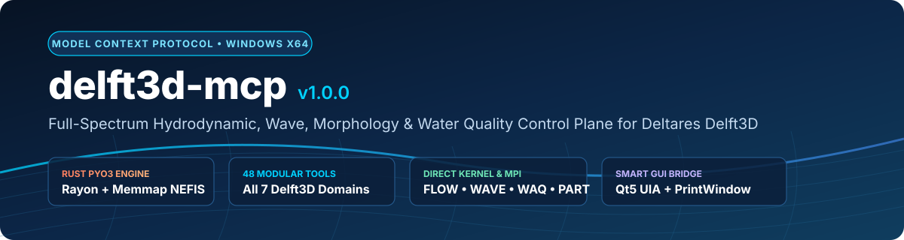
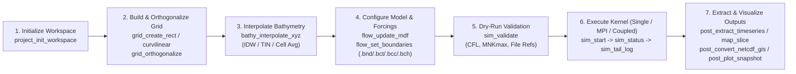
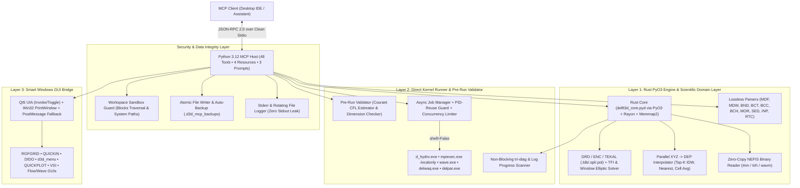

<p align="center">
  
</p>

<p align="center">
  
  
  
  
  
  
</p>

**`delft3d-mcp`** is a high-performance **Model Context Protocol (MCP)** server that gives MCP-compatible desktop clients complete, deterministic control over **Deltares Delft3D** on Windows—covering curvilinear grid generation, bathymetry interpolation, hydrodynamic/wave/morphology/water-quality model authoring, parallel MPI simulation execution, native NEFIS binary extraction, and live Windows GUI automation.

---

## Key Capabilities at a Glance

- **Native Rust Compute Core (`delft3d_core`)**: Memory-mapped (`memmap2`) 32/64-bit **NEFIS** binary reader (`trim-*`, `trih-*`, `wavm-*`), **Transfinite Interpolation (TFI)** curvilinear grid generator, **Winslow Elliptic Grid Orthogonalizer**, parallel (`rayon`) **IDW / Nearest / Cell-Average** bathymetry interpolation, and non-blocking `tri-diag` log scanner.
- **Complete 7-Domain Delft3D Coverage (48 Tools)**: Full read/write/run parity across **RGFGRID**, **QUICKIN**, **DIDO**, **Delft3D-FLOW (2D/3D & Morphology)**, **Delft3D-WAVE (SWAN)**, **Delft3D-WAQ**, **Delft3D-PART**, **TIDE/WES/RTC**, and **QUICKPLOT**.
- **Pre-Run Physics & Dimension Validator**: Automatically checks Courant-Friedrichs-Lewy (**CFL**) stability numbers, `(M, N)` grid/bathymetry padding alignment, and missing file references before launching kernels.
- **Zero-Fragility Native Kernel Runner**: Spawns `d_hydro.exe`, `mpiexec.exe -localonly`, coupled `wave.exe <mdw> 1`, `delwaq.exe`, and `delpar.exe` directly (`shell=False`) with isolated job logs so MCP `stdio` JSON-RPC framing is never polluted.
- **Defense-in-Depth Sandbox & Auto-Rollback**: Strict workspace path containment (`WorkspaceRegistry`), atomic file replacement, and automatic timestamped `.d3d_mcp_backups` snapshots prior to every model edit.

---

## End-to-End Workflow Flowchart



---

## 3-Layer Hybrid Polyglot Architecture



---

## Delft3D Version Compatibility Matrix

`delft3d-mcp` includes a **Multi-Version & Multi-Layout Auto-Resolver** (`Delft3DPaths.discover()`) that automatically detects your installed Delft3D version from `DELFT3D_ROOT`, `D3D_HOME`, or standard Windows installation directories (`C:\Program Files\Deltares\Delft3D*`, `C:\Delft3D*`).

| Delft3D Version / Mode | Directory Layout | Compatibility Status | Supported Capabilities |
| :--- | :--- | :--- | :--- |
| **Delft3D 4.05.xx – 4.07.02+** *(Modern Deltares Installer / OSS Build)* | `kernels\x64\bin` + `guis\x64\...` | **100% Full Native Support** | All 48 tools: FLOW, MPI, coupled WAVE (`wave.exe <mdw> 1`), WAQ, PART, TIDE, WES, RTC, NEFIS, NetCDF4, and Qt5/Tcl-Tk GUI Bridge (`mfe_app.exe`, `d3d_menu.exe`, `d3d_qp.exe`). |
| **Delft3D 4.01.xx – 4.04.xx** *(Classic Unified `x64` / `win32` Build)* | `x64\<module>\bin` or `w32\<module>\bin` | **Auto-Resolved Compatible** | Automatic fallback to classic binary paths (`x64\dflow2d3d\bin\d_hydro.exe` / `trisim.exe`, `delwaq2.exe`, standalone `rgfgrid.exe`/`quickin.exe`), plus full domain & NEFIS support. |
| **Headless / File-Only Workstation** *(No Local Delft3D Binaries Installed)* | `headless_file_only` | **Full Pre/Post-Processing** | Grid generation (`TFI`, `Elliptic`, `TEKAL`), Bathymetry interpolation (`IDW`, `TIN`, `Cell Avg`), MDF/MDW/Boundary authoring, native **NEFIS `.dat`/`.def` reading**, NetCDF4/GeoJSON export, harmonic tidal analysis, and skill metrics work **without** Delft3D installed. |

---

## Quick Installation & MCP Client Setup

### Option A: From Precompiled Public Release Wheel (`dist/public/`)

```powershell
# Install the precompiled Windows x64 wheel into an isolated Python 3.12 tool environment
uv tool install --python 3.12 --force .\delft3d_mcp-1.0.0-cp312-cp312-win_amd64.whl
```

### Option B: From Local Repository Environment

```powershell
uv sync --python 3.12 --all-groups
```

### MCP Client Configuration (`mcp_config.json` / `claude_desktop_config.json`)

```json
{
  "mcpServers": {
    "delft3d": {
      "command": "D:\\AI Project\\delft3d-mcp\\.venv\\Scripts\\python.exe",
      "args": ["-m", "delft3d_mcp"],
      "env": {
        "DELFT3D_ROOT": "C:\\Program Files\\Deltares\\Delft3D 4.07.02"
      }
    }
  }
}
```
*(Note: `DELFT3D_ROOT` is optional; if omitted, `delft3d-mcp` auto-discovers the latest installed Delft3D 4.x folder on your machine).*

---

## Complete Catalog of 48 MCP Tools

### 1. Project & Workspace Safety (5 Tools)
| Tool Name | Key Parameters | Purpose & Practical Usage |
| :--- | :--- | :--- |
| `project_init_workspace` | `path`, `name`, `create` | Register and activate a sandboxed model directory before any file read/write/run. |
| `project_inspect` | `workspace` | Detect installed Delft3D version/layout and inventory all `.mdf`, `.mdw`, `.grd`, `.dep`, `.inp`, `.dat` files. |
| `project_list_files` | `pattern`, `workspace` | Glob search files inside the active sandboxed workspace. |
| `project_backup` | `file_path` (`"*"` to list), `label` | Snapshot a file into `.d3d_mcp_backups/<timestamp>/` or list existing snapshots. |
| `project_rollback` | `snapshot_id` | Atomically restore model files from a backup snapshot ID. |

### 2. Grid Generation & RGFGRID Parity (10 Tools)
| Tool Name | Key Parameters | Purpose & Practical Usage |
| :--- | :--- | :--- |
| `grid_inspect` | `grd_path` | Read `.grd` dimensions `(m_max, n_max)`, coordinate system, and spatial bounding box. |
| `grid_create_rect` | `out_grd_path`, `x0`, `y0`, `dx`, `dy`, `m_max`, `n_max`, `angle_deg` | Generate a structured rectangular or rotated curvilinear `.grd` mesh. |
| `grid_create_curvilinear` | `out_grd_path`, `south`, `north`, `m_max`, `n_max`, `west`, `east`, `ortho_iterations` | Generate a boundary-fitted curvilinear grid from 2 opposing splines or 4 curves via **TFI + Winslow Elliptic smoothing**. |
| `grid_orthogonalize` | `src_grd_path`, `dst_grd_path`, `iterations`, `omega` | Run Winslow elliptic orthogonalization on an existing `.grd` to reduce `|cos(theta)| < 0.04`. |
| `grid_refine` | `src_grd_path`, `dst_grd_path`, `factor_m`, `factor_n` | Sub-divide grid cells by `(factor_m, factor_n)` via bilinear refinement. |
| `grid_check_quality` | `grd_path` | Compute parallel RGFGRID quality metrics: max/mean orthogonality cosine, M/N smoothness, aspect ratio, min/max `dx`/`dy`. |
| `grid_transform_or_mask` | `src_grd_path`, `dx`, `dy`, `scale_x`, `scale_y`, `rotate_deg`, `mask_block`, `mask_interior` | Shift, scale, or rotate a grid, or delete interior/exterior nodes in `[m1, m2, n1, n2]`. |
| `grid_edit_enclosure` | `enc_path`, `points` | Read or write a `.enc` computational grid enclosure polygon. |
| `grid_tekal_io` | `tekal_path`, `action` (`read`/`write`/`import_geojson`), `features`, `geojson_path` | Read/write RGFGRID TEKAL files (`.ldb`, `.spl`, `.pol`) or convert directly from GIS GeoJSON. |
| `grid_export_geojson` | `grd_path`, `out_geojson_path`, `stride` | Export `.grd` mesh lines to GeoJSON for QGIS/GIS visualization. |

### 3. Bathymetry & QUICKIN Operations Parity (5 Tools)
| Tool Name | Key Parameters | Purpose & Practical Usage |
| :--- | :--- | :--- |
| `bathy_inspect` | `dep_path`, `grd_path` | Inspect `.dep` matrix (raw or `MNKmax`-padded) and compute valid/missing/min/max/mean depth statistics. |
| `bathy_interpolate_xyz` | `grd_path`, `xyz_path`, `out_dep_path`, `method` (`idw`/`nearest`/`cell_average`/`tin`), `flow_pad` | Interpolate scatter `.xyz` soundings onto `.grd` with optional automatic `-999.0` border padding for FLOW. |
| `bathy_smooth_or_fill` | `dep_path`, `grd_path`, `iterations`, `fill_only` | Fill `-999.0` missing depth gaps or apply iterative Laplace bathymetry smoothing. |
| `bathy_edit_region` | `dep_path`, `grd_path`, `m_range`, `n_range`, `operation` (`set`/`add`/`scale`), `value` | Modify bathymetry values inside a sub-grid index box. |
| `bathy_operations` | `action` (`volumes_areas`/`combine`/`samples_from_tekal`), `dep_path`, `grd_path`, `second_dep_path`, `combine_op`, `z_ref` | Full QUICKIN `Operations` parity: wet surface area & storage volume integration, combining two `.dep` files, or generating `.xyz` samples from TEKAL polylines. |

### 4. Delft3D-FLOW, Transport & Morphology (7 Tools)
| Tool Name | Key Parameters | Purpose & Practical Usage |
| :--- | :--- | :--- |
| `flow_read_mdf` | `mdf_path` | Parse `.mdf` into structured key-values and list all referenced attribute files. |
| `flow_update_mdf` | `mdf_path`, `updates` | Losslessly update or create `.mdf` keywords while preserving comments and type formatting. |
| `flow_set_boundaries` | `bnd_path`, `boundaries`, `bct_path`, `bct_tables`, `bcc_path`, `bch_path`, `src_path`, `dis_path`, `mdf_path` | Generate `.bnd`, `.bct` (time-series), `.bcc` (salinity/temp/sediment), `.bch` (harmonic), and `.src`/`.dis` (discharges) and link to `.mdf`. |
| `flow_set_obs_crs` | `obs_path`, `stations`, `crs_path`, `cross_sections`, `wnd_path`, `wind_records` | Write observation stations (`.obs`), monitoring cross-sections (`.crs`), and uniform wind series (`.wnd`). |
| `flow_set_thin_dams_dry` | `dry_path`, `dry_points`, `thd_path`, `thin_dams` | Write permanently dry cell points (`.dry`) and U/V thin dams (`.thd`). |
| `flow_config_morphology` | `mor_path`, `mor_sections`, `sed_path`, `sed_sections` | Read or write morphology (`.mor`) and sediment fraction (`.sed`) files. |
| `flow_setup_dd` | `ddb_path`, `links` | Generate Domain Decomposition (`.ddb`) multi-grid coupling definitions. |

### 5. WAVE (SWAN), WAQ, PART, TIDE, WES & RTC (5 Tools)
| Tool Name | Key Parameters | Purpose & Practical Usage |
| :--- | :--- | :--- |
| `wave_read_write_mdw` | `mdw_path`, `sections` | Read or write Delft3D-WAVE (`.mdw`) spectral wave configuration files. |
| `waq_edit_inp` | `inp_path`, `section_updates` | Inspect or update numbered blocks (`#1`..`#10`) in a Delft3D-WAQ `.inp` file. |
| `waq_list_processes` | `query`, `limit` | Search available water-quality substances and processes in `proctabl.d3d`. |
| `part_edit_inp` | `inp_path`, `params` | Generate or update Delft3D-PART particle tracking input files (`.inp`/`.par`). |
| `tide_wes_generate` | `tool_kind` (`wes`/`tide`/`rtc`/`harmonic_fit`), `out_path`, `params` | Generate cyclone spiderweb wind (`WES`), `TIDE`, or `RTC` configs, or run least-squares tidal harmonic decomposition & prediction (`M2`, `S2`, `N2`, `K2`, `K1`, `O1`, `P1`, `Q1`, `M4`, `MS4`). |

### 6. Native Simulation Runner & Async Job Manager (6 Tools)
| Tool Name | Key Parameters | Purpose & Practical Usage |
| :--- | :--- | :--- |
| `sim_validate` | `input_path`, `module` (`flow`/`wave`) | Pre-run dry validator: checks missing referenced files, grid/depth dimension alignment, and Courant (**CFL**) number. |
| `sim_start` | `mode` (`flow_single`, `flow_mpi`, `flow_wave_coupled`, `flow_dd`, `wave_standalone`, `waq`, `part`), `input_path`, `wave_mdw_path`, `num_procs` | Launch a non-blocking simulation job with automatic `config_d_hydro.xml` generation and MPI `-localonly` support. |
| `sim_status` | `job_id` | Poll status (`running`, `completed`, `failed`, `stopped`), PIDs, and exit codes of managed jobs. |
| `sim_tail_log` | `log_or_diag_path`, `tail_n` | High-speed Rust scanner for `tri-diag.*` / `*.mon` progress percentage, warnings, and errors. |
| `sim_stop` | `job_id` | Safely terminate a running job and its child MPI/WAVE processes (protected by PID-reuse verification). |
| `sim_run_utility` | `utility` (`agrhyd`, `ddcouple`, `mormerge`, `nesthd1`, `nesthd2`, `wes`, `tide_analysis`, `tide_predict`, `maptonetcdf`, `sim2ugrid`, `delft3d2shape`, `delwaq2raster`, `vs`, `plct`, `nestwq1`, `nestwq2`, `waqmerge`, `triana`), `work_dir_path`, `args` | Run any Delft3D CLI utility synchronously with isolated environment injection. |

### 7. Native NEFIS Post-Processing, NetCDF & Validation (6 Tools)
| Tool Name | Key Parameters | Purpose & Practical Usage |
| :--- | :--- | :--- |
| `post_list_nefis_vars` | `dat_path`, `def_path` | List all groups (`map-series`, `his-series`, `map-const`, etc.), dimensions, and element names inside a NEFIS `.dat`/`.def` pair. |
| `post_extract_timeseries` | `dat_path`, `group_name`, `element_name`, `vd_start`, `vd_end` | Extract station/cross-section time-series arrays (e.g. `ZWL`, `ZCURU`, `CTR`) from `trih-*` in microseconds via Rust `memmap2`. |
| `post_extract_map_slice` | `dat_path`, `group_name`, `element_name`, `time_index` | Extract 2D/3D spatial field slices (e.g. `S1`, `U1`, `V1`, `DP0`, `HSIGN`) at a specific time step from `trim-*` or `wavm-*`. |
| `post_convert_netcdf_gis` | `converter` (`nefis_to_netcdf`, `sim2ugrid`, `maptonetcdf`, `delwaq2raster`, `delft3d2shape`), `work_dir_path`, `args` | Export NEFIS `.dat`/`.def` directly to **CF-friendly NetCDF4 (`.nc`)** or invoke Deltares GIS converters. |
| `post_validate_skill` | `observed`, `simulated` | Compute hydrodynamic calibration metrics: **RMSE**, **MAE**, **Bias**, **Pearson $r$**, **Nash-Sutcliffe Efficiency (NSE)**, and **Willmott Index of Agreement ($d$)**. |
| `post_plot_snapshot` | `plot_kind` (`grid_bathy`/`timeseries`), `out_png_path`, `grd_path`, `dep_path`, `times`, `values` | Render publication-ready 150-DPI PNG plots of curvilinear meshes, bathymetry contours, or time series headlessly. |

### 8. Smart Windows Desktop GUI Bridge (4 Tools)
| Tool Name | Key Parameters | Purpose & Practical Usage |
| :--- | :--- | :--- |
| `gui_launch_module` | `module` (`menu`, `rgfgrid`, `quickin`, `dido`, `flow_gui`, `wave_gui`, `waq_gui`, `part_gui`, `quickplot`, `vsi`), `work_dir_path`, `target_file` | Launch any Delft3D desktop GUI application with proper `QT_PLUGIN_PATH` and `WL_PLUGINS_HOME` environment variables. |
| `gui_list_windows` | `inspect_qt5_hwnd` | Enumerate open Delft3D HWNDs and inspect their live Qt5 UI Automation tree (`MenuBar`, `ToolBar`, `Button`, `CheckBox`, `StatusBar`). |
| `gui_ui_action` | `hwnd`, `backend` (`qt5`/`tcltk`), `action` (`menu_select`, `click_button`, `set_text`, `send_keys`, `read_status_bar`, `canvas_click_points`, `canvas_drag`, `close`) | Trigger menus, toggle toolbar buttons (`uia_toggle`/`uia_invoke`), read live cursor coordinates from the status bar, or draw on the OpenGL canvas. |
| `gui_capture_screenshot` | `out_png_path`, `hwnd`, `title_contains` | Capture crisp PNG screenshots of Qt5/OpenGL Delft3D windows using Win32 `PrintWindow (PW_RENDERFULLCONTENT)` with `mss` fallback. |

---

## Security & Operational Guarantees

- **Sandboxed File Operations**: Every path passed to any tool is canonicalized via `Path.resolve()` and verified with `.is_relative_to(workspace_root)`. System folders (`C:\Windows`, `C:\Program Files`, drive roots `C:\`/`D:\`, and the Delft3D installation folder) cannot be registered as writable workspaces.
- **PID-Reuse Process Protection**: Background job termination verifies that the target Windows PID matches an allowlisted Delft3D kernel binary name (`d_hydro.exe`, `mpiexec.exe`, `wave.exe`, `delwaq.exe`, `delpar.exe`) before sending termination signals.
- **Zero Proprietary Bundling**: This package contains original integration code only and dynamically invokes the user's local Delft3D installation.

---

## Author & License

- **Author**: Diky Dwi Anggara Permadi ([@dikydwi442-byte](https://github.com/dikydwi442-byte))
- **License**: [MIT License](LICENSE)
