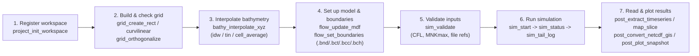
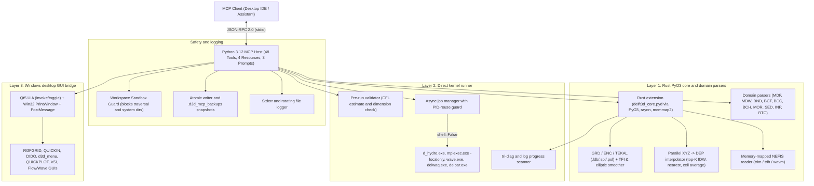

<p align="center">
  
</p>

<h1 align="center">delft3d-mcp</h1>

<p align="center">
  
  
  
  
  
  
</p>

`delft3d-mcp` is a Windows Model Context Protocol (MCP) server for Deltares Delft3D. It lets MCP-compatible desktop clients build grids, interpolate bathymetry, edit model inputs, launch local or MPI simulations, read NEFIS binary outputs, and control Delft3D desktop windows.

## What it covers

- Memory-mapped 32-bit and 64-bit NEFIS reader (`trim-*`, `trih-*`, `wavm-*`), Transfinite Interpolation (TFI) curvilinear grid builder, Winslow elliptic orthogonalizer, parallel bathymetry interpolation (`idw`, `nearest`, `cell_average`), and a non-blocking `tri-diag` log scanner written in Rust (`delft3d_core`).
- 48 tools covering RGFGRID, QUICKIN, DIDO, Delft3D-FLOW (2D/3D and morphology), Delft3D-WAVE (SWAN), Delft3D-WAQ, Delft3D-PART, TIDE, WES, RTC, and QUICKPLOT.
- Pre-run validation that estimates Courant (CFL) numbers, checks `(M, N)` grid and bathymetry dimensions, and verifies referenced attribute files before a run starts.
- Direct process execution (`shell=False`) for `d_hydro.exe`, `mpiexec.exe -localonly`, coupled `wave.exe <mdw> 1`, `delwaq.exe`, and `delpar.exe` with output routed to job logs so MCP `stdio` JSON-RPC framing stays intact.
- Sandboxed file access limited to registered project folders (`WorkspaceRegistry`), with atomic writes and automatic backups saved under `.d3d_mcp_backups/`.

## Typical workflow



## Architecture



## Delft3D version compatibility

`Delft3DPaths.discover()` checks `DELFT3D_ROOT`, `D3D_HOME`, and standard Windows install paths (`C:\Program Files\Deltares\Delft3D*`, `C:\Program Files (x86)\Deltares\Delft3D*`, `C:\Delft3D*`).

| Delft3D version or mode | Directory layout | Status | What works |
| :--- | :--- | :--- | :--- |
| Delft3D 4.05.xx to 4.07.02+ (modern installer / OSS) | `kernels\x64\bin` + `guis\x64\...` | Full support | All 48 tools: FLOW, MPI, coupled WAVE (`wave.exe <mdw> 1`), WAQ, PART, TIDE, WES, RTC, NEFIS, NetCDF4, and the GUI bridge (`mfe_app.exe`, `d3d_menu.exe`, `d3d_qp.exe`). |
| Delft3D 4.01.xx to 4.04.xx (classic `x64` / `win32`) | `x64\<module>\bin` or `w32\<module>\bin` | Compatible (auto-detected) | Falls back to classic binary paths (`d_hydro.exe` / `trisim.exe`, `delwaq2.exe`, `rgfgrid.exe`, `quickin.exe`) along with all domain and NEFIS tools. |
| Headless / file-only workstation (no Delft3D installed) | `headless_file_only` | Pre- and post-processing | Grid building (`TFI`, elliptic smoothing, `TEKAL`), bathymetry interpolation (`idw`, `tin`, `cell_average`), MDF/MDW/boundary editing, NEFIS `.dat`/`.def` reading, NetCDF4/GeoJSON export, harmonic analysis, and skill metrics. |

## Installation

### From the precompiled wheel (`dist/public/`)

```powershell
uv tool install --python 3.12 --force .\delft3d_mcp-1.0.0-cp312-cp312-win_amd64.whl
```

### From a local clone

```powershell
uv sync --python 3.12 --all-groups
```

### MCP client configuration (`mcp_config.json` or `claude_desktop_config.json`)

```json
{
  "mcpServers": {
    "delft3d": {
      "command": "D:\\AI Project\\delft3d-mcp\\.venv\\Scripts\\python.exe",
      "args": ["-m", "delft3d_mcp"],
      "env": {
        "DELFT3D_ROOT": "C:\\Program Files\\Deltares\\Delft3D 4.07.02"
      }
    }
  }
}
```

`DELFT3D_ROOT` is optional. When omitted, the server scans local Deltares install folders automatically.

## Tool reference (48 tools)

### 1. Project and workspace safety (5 tools)
| Tool | Key parameters | What it does |
| :--- | :--- | :--- |
| `project_init_workspace` | `path`, `name`, `create` | Registers and activates a sandboxed project folder. |
| `project_inspect` | `workspace` | Reports the detected Delft3D version/layout and lists `.mdf`, `.mdw`, `.grd`, `.dep`, `.inp`, and `.dat` files. |
| `project_list_files` | `pattern`, `workspace` | Lists files matching a glob pattern inside the workspace. |
| `project_backup` | `file_path` (`"*"` to list), `label` | Saves a timestamped snapshot in `.d3d_mcp_backups/` or lists existing backups. |
| `project_rollback` | `snapshot_id` | Restores files from a saved backup snapshot. |

### 2. Grid generation and RGFGRID tools (10 tools)
| Tool | Key parameters | What it does |
| :--- | :--- | :--- |
| `grid_inspect` | `grd_path` | Reads `.grd` dimensions `(m_max, n_max)`, coordinate system, and bounding box. |
| `grid_create_rect` | `out_grd_path`, `x0`, `y0`, `dx`, `dy`, `m_max`, `n_max`, `angle_deg` | Creates a rectangular or rotated `.grd` mesh. |
| `grid_create_curvilinear` | `out_grd_path`, `south`, `north`, `m_max`, `n_max`, `west`, `east`, `ortho_iterations` | Builds a curvilinear grid from 2 opposing splines or 4 curves using TFI and Winslow elliptic smoothing. |
| `grid_orthogonalize` | `src_grd_path`, `dst_grd_path`, `iterations`, `omega` | Smooths an existing `.grd` mesh to lower `|cos(theta)|` toward 0. |
| `grid_refine` | `src_grd_path`, `dst_grd_path`, `factor_m`, `factor_n` | Subdivides grid cells by `(factor_m, factor_n)`. |
| `grid_check_quality` | `grd_path` | Computes orthogonality cosine, M/N smoothness ratios, aspect ratio, and min/max `dx`/`dy`. |
| `grid_transform_or_mask` | `src_grd_path`, `dx`, `dy`, `scale_x`, `scale_y`, `rotate_deg`, `mask_block`, `mask_interior` | Shifts, scales, or rotates a grid, or masks nodes inside/outside `[m1, m2, n1, n2]`. |
| `grid_edit_enclosure` | `enc_path`, `points` | Reads or writes `.enc` enclosure polygons. |
| `grid_tekal_io` | `tekal_path`, `action` (`read`/`write`/`import_geojson`), `features`, `geojson_path` | Reads/writes TEKAL files (`.ldb`, `.spl`, `.pol`) or imports them from GeoJSON. |
| `grid_export_geojson` | `grd_path`, `out_geojson_path`, `stride` | Exports `.grd` grid lines to GeoJSON. |

### 3. Bathymetry and QUICKIN tools (5 tools)
| Tool | Key parameters | What it does |
| :--- | :--- | :--- |
| `bathy_inspect` | `dep_path`, `grd_path` | Reads `.dep` files (raw or `MNKmax`-padded) and returns valid/missing counts and depth stats. |
| `bathy_interpolate_xyz` | `grd_path`, `xyz_path`, `out_dep_path`, `method` (`idw`/`nearest`/`cell_average`/`tin`), `flow_pad` | Interpolates `.xyz` soundings onto `.grd`, optionally adding `-999.0` FLOW border padding. |
| `bathy_smooth_or_fill` | `dep_path`, `grd_path`, `iterations`, `fill_only` | Fills `-999.0` gaps or smooths active depth nodes via Laplace relaxation. |
| `bathy_edit_region` | `dep_path`, `grd_path`, `m_range`, `n_range`, `operation` (`set`/`add`/`scale`), `value` | Edits depths within a 1-based `[m1, m2] x [n1, n2]` region. |
| `bathy_operations` | `action` (`volumes_areas`/`combine`/`samples_from_tekal`), `dep_path`, `grd_path`, `second_dep_path`, `combine_op`, `z_ref` | Computes wet surface area and water volume, combines two `.dep` files, or converts TEKAL polylines to `.xyz` samples. |

### 4. Delft3D-FLOW and morphology (7 tools)
| Tool | Key parameters | What it does |
| :--- | :--- | :--- |
| `flow_read_mdf` | `mdf_path` | Parses `.mdf` keywords and referenced sub-files. |
| `flow_update_mdf` | `mdf_path`, `updates` | Updates or adds `.mdf` keywords while keeping comments intact. |
| `flow_set_boundaries` | `bnd_path`, `boundaries`, `bct_path`, `bct_tables`, `bcc_path`, `bch_path`, `src_path`, `dis_path`, `mdf_path` | Writes `.bnd`, `.bct`, `.bcc`, `.bch`, and `.src`/`.dis` files and links them into `.mdf`. |
| `flow_set_obs_crs` | `obs_path`, `stations`, `crs_path`, `cross_sections`, `wnd_path`, `wind_records` | Writes observation points (`.obs`), cross-sections (`.crs`), and uniform wind (`.wnd`). |
| `flow_set_thin_dams_dry` | `dry_path`, `dry_points`, `thd_path`, `thin_dams` | Writes dry cell points (`.dry`) and U/V thin dams (`.thd`). |
| `flow_config_morphology` | `mor_path`, `mor_sections`, `sed_path`, `sed_sections` | Reads or writes morphology (`.mor`) and sediment (`.sed`) files. |
| `flow_setup_dd` | `ddb_path`, `links` | Generates Domain Decomposition (`.ddb`) coupling files. |

### 5. WAVE, WAQ, PART, TIDE, WES, and RTC (5 tools)
| Tool | Key parameters | What it does |
| :--- | :--- | :--- |
| `wave_read_write_mdw` | `mdw_path`, `sections` | Reads or writes Delft3D-WAVE `.mdw` files. |
| `waq_edit_inp` | `inp_path`, `section_updates` | Reads or replaces numbered sections (`#1` to `#10`) in Delft3D-WAQ `.inp` files. |
| `waq_list_processes` | `query`, `limit` | Searches water-quality processes in `proctabl.d3d`. |
| `part_edit_inp` | `inp_path`, `params` | Generates or updates Delft3D-PART `.inp`/`.par` files. |
| `tide_wes_generate` | `tool_kind` (`wes`/`tide`/`rtc`/`harmonic_fit`), `out_path`, `params` | Writes `WES`, `TIDE`, or `RTC` configs, or runs least-squares tidal harmonic decomposition and prediction. |

### 6. Simulation runner and job manager (6 tools)
| Tool | Key parameters | What it does |
| :--- | :--- | :--- |
| `sim_validate` | `input_path`, `module` (`flow`/`wave`) | Checks missing file references, `MNKmax` vs `.grd`/`.dep` sizes, and estimated Courant (CFL) numbers. |
| `sim_start` | `mode` (`flow_single`, `flow_mpi`, `flow_wave_coupled`, `flow_dd`, `wave_standalone`, `waq`, `part`), `input_path`, `wave_mdw_path`, `num_procs` | Starts a non-blocking run, writes `config_d_hydro.xml`, and configures MPI `-localonly` when needed. |
| `sim_status` | `job_id` | Returns status (`running`, `completed`, `failed`, `stopped`), PIDs, and exit codes. |
| `sim_tail_log` | `log_or_diag_path`, `tail_n` | Scans `tri-diag.*` or `*.mon` files for progress lines, warnings, and errors. |
| `sim_stop` | `job_id` | Stops a running job and its child MPI/WAVE processes after verifying process names. |
| `sim_run_utility` | `utility` (`agrhyd`, `ddcouple`, `mormerge`, `nesthd1`, `nesthd2`, `wes`, `tide_analysis`, `tide_predict`, `maptonetcdf`, `sim2ugrid`, `delft3d2shape`, `delwaq2raster`, `vs`, `plct`, `nestwq1`, `nestwq2`, `waqmerge`, `triana`, `kubint`, `lint`, `datsel`), `work_dir_path`, `args` | Runs short Delft3D CLI utilities synchronously. |

### 7. NEFIS post-processing, NetCDF, and skill checks (6 tools)
| Tool | Key parameters | What it does |
| :--- | :--- | :--- |
| `post_list_nefis_vars` | `dat_path`, `def_path` | Lists groups, dimensions, and elements inside a NEFIS `.dat`/`.def` file pair. |
| `post_extract_timeseries` | `dat_path`, `group_name`, `element_name`, `vd_start`, `vd_end` | Extracts time-series arrays (such as `ZWL`, `ZCURU`, `CTR`) from `trih-*` files. |
| `post_extract_map_slice` | `dat_path`, `group_name`, `element_name`, `time_index` | Extracts spatial slices (`S1`, `U1`, `V1`, `DP0`, `HSIGN`) at a chosen time step from `trim-*` or `wavm-*`. |
| `post_convert_netcdf_gis` | `converter` (`nefis_to_netcdf`, `sim2ugrid`, `maptonetcdf`, `delwaq2raster`, `delft3d2shape`), `work_dir_path`, `args` | Exports NEFIS data directly to NetCDF4 (`.nc`) or runs Deltares GIS/UGRID converters. |
| `post_validate_skill` | `observed`, `simulated` | Calculates RMSE, MAE, bias, Pearson `r`, Nash-Sutcliffe efficiency (NSE), and Willmott `d`. |
| `post_plot_snapshot` | `plot_kind` (`grid_bathy`/`timeseries`), `out_png_path`, `grd_path`, `dep_path`, `times`, `values` | Saves 150-DPI PNG plots of grids, bathymetry, or time series headlessly. |

### 8. Windows desktop GUI bridge (4 tools)
| Tool | Key parameters | What it does |
| :--- | :--- | :--- |
| `gui_launch_module` | `module` (`menu`, `rgfgrid`, `quickin`, `dido`, `flow_gui`, `wave_gui`, `waq_gui`, `part_gui`, `quickplot`, `vsi`), `work_dir_path`, `target_file` | Launches a Delft3D GUI program with the required Qt and plugin environment variables. |
| `gui_list_windows` | `inspect_qt5_hwnd` | Lists open Delft3D windows and optionally dumps the Qt5 UI Automation tree. |
| `gui_ui_action` | `hwnd`, `backend` (`qt5`/`tcltk`), `action` (`menu_select`, `click_button`, `click_screen_point`, `set_text`, `send_keys`, `read_status_bar`, `canvas_click_points`, `canvas_drag`, `close`) | Runs menu items, toggles toolbar buttons, reads the cursor status bar, or clicks/drags on the OpenGL canvas. |
| `gui_capture_screenshot` | `out_png_path`, `hwnd`, `title_contains` | Captures a Delft3D window to PNG via Win32 `PrintWindow` with `mss` fallback. |

## Security

Every path is resolved and checked with `Path.is_relative_to(workspace_root)` before reading or writing. System locations (`C:\Windows`, `C:\Program Files`, drive roots like `C:\`, and the Delft3D install directory) are blocked from workspace registration. Process termination checks executable names against a kernel allowlist (`d_hydro.exe`, `mpiexec.exe`, `wave.exe`, `delwaq.exe`, `delpar.exe`) to avoid killing unrelated programs on PID reuse. No Deltares binaries or GPL files are bundled in this repository.

## Author and license

Maintained by Diky Dwi Anggara Permadi ([@dikydwi442-byte](https://github.com/dikydwi442-byte)) under the [MIT License](LICENSE).
